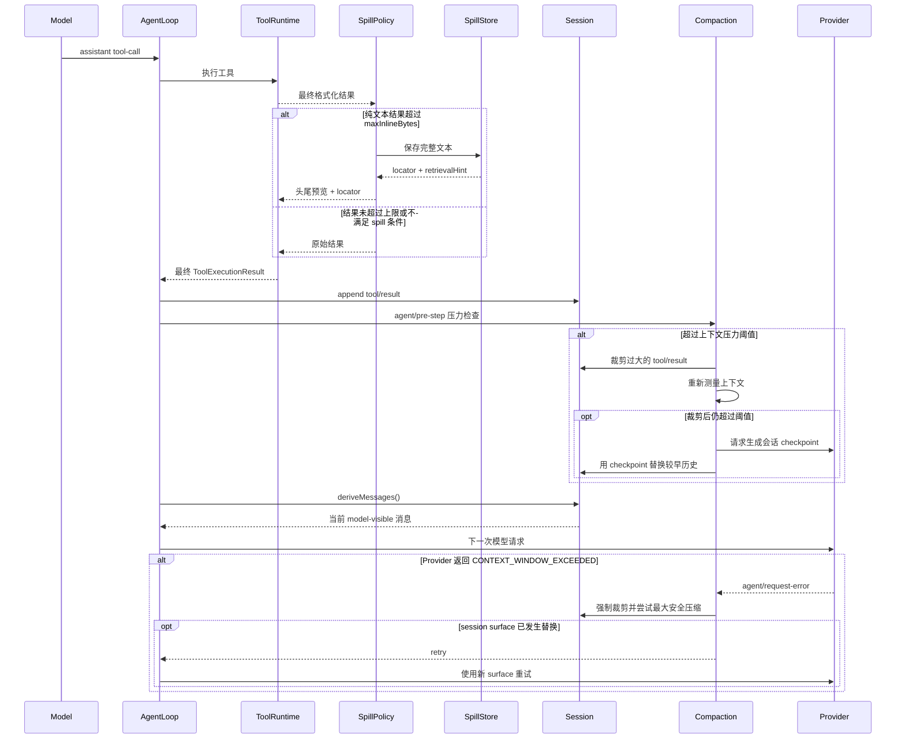

Agent 调用工具时，结果可能远比预期大：一条命令吐出几万行日志，一次检索返回整批文档，或者某个 API 直接交回一份巨大的 JSON。假如框架不加处理地把这些内容塞进下一次模型请求，轻则挤掉真正重要的历史，重则直接超过模型上下文窗口，让这一轮无法继续。

Deepseek Harness（下称 DSH）的处理思路不是“先把全文交给模型，再请模型自己摘要”。它把问题拆成了几层：**完整结果留在可追溯的外部存储里，模型只看到有界预览；当会话整体继续逼近窗口时，再依次裁剪工具结果、压缩较早历史；主动估算仍有漏判时，最后由 provider 的溢出错误触发恢复。**

这条链路里有两个容易混淆的对象：append-only session log 保存发生过什么，当前 session surface 决定下一次模型请求实际能看到什么。理解这一区别，也就理解了 DSH 为什么既能缩小上下文，又不需要篡改历史。

本文沿着一次超大工具结果的生命周期，把 spill、session、pruning、compaction 与溢出恢复完整走一遍。

## 1. 先看全链路：五层防线各管一段

一次工具调用结束后，结果不会立刻原样进入下一次模型请求。它先经过工具执行阶段的 spill 策略，再被写入 session；下一 step 开始前，compaction 根据上下文压力决定是否进一步裁剪或总结。若主动检查仍未挡住溢出，provider 错误会触发最后一次恢复。



这五层不是重复保险：spill 处理的是**单次工具结果的体积**，pruning 和 checkpoint compaction 处理的是**整个请求的上下文压力**，provider 恢复则处理**估算与真实 tokenizer 之间的误差**。

## 2. 第一层：把完整结果 spill 出去

默认组合会安装两个包：

- `@deepseek-ai/dsh-spill-local`
- `@deepseek-ai/dsh-spill-policy`

默认配置把单次 inline 结果的上限设为 50,000 bytes：

```yaml
- id: spill-local
  name: '@deepseek-ai/dsh-spill-local'

- id: spill-policy
  name: '@deepseek-ai/dsh-spill-policy'
  config:
    maxInlineBytes: 50000
```

### 2.1 哪些结果会触发 spill

`spill-policy` 在 `tools/post-execute` 阶段看到的是已经完成格式化的最终结果。模型侧通用 spill 只有同时满足以下条件才会执行：

- 调用属于一个 session；
- 结果只包含 `text` block；
- 不是嵌套工具调用；
- 工具名称不是 `read`；
- post-execute 决策是普通 `accept`；
- UTF-8 大小超过 `maxInlineBytes`；
- `ctx.spillStore` 能成功保存完整文本。

这些条件说明，spill 不是对所有工具内容一刀切的截断器。它针对的是可以安全落盘、随后又能按路径读取的纯文本结果。

### 2.2 模型看到什么

spill 成功后，完整文本写入 session-scoped 文件，工具结果则被替换成头尾预览和定位信息：

```text
<头部预览>
...
<尾部预览>

(Omitted 123456 bytes. Full formatted result stored at:
 /tmp/dsh-spill-xxx/session-xxx/abc-tool.txt.
 Use read with offset/limit, or grep this path to search within it.)
```

整个替换文本——包括预览、空行和提示——都不会超过 `maxInlineBytes`。模型因此知道“中间省略了多少、全文在哪里、应该怎么查”，却不必为暂时用不到的正文支付上下文成本。

### 2.3 文件如何组织

本地 backend 使用下面的结构保存文件：

```text
<spill-root>/session-<session-id-hash>/<random>-<safe-name>
```

每个 session 有独立目录，文件名带随机前缀，权限只对 owner 开放，locator 是本地绝对路径。retrieval hint 会引导模型使用 `read offset/limit` 或 `grep`。

这里最重要的一点是：**spill 文件不会自动重新注入模型上下文。** 完整结果虽然被保留下来，但只有模型主动读取时，所需片段才会重新进入工具调用链路。

## 3. 第二层：session 记录的是有界结果

spill-policy 返回以后，agent-loop 使用最终的 `result.content` 创建 `tool/result`：

```ts
{
  type: 'tool/result',
  data: {
    turn,
    step,
    message: {
      role: 'user',
      source: {
        kind: 'tool',
        callId: 'call_123'
      },
      content: [{
        type: 'tool-result',
        toolCallId: 'call_123',
        content: [{
          type: 'text',
          text: '<preview + spill locator>'
        }],
        isError: false
      }]
    }
  },
  surfaceOp: 'append',
  sourceEventSeqs: [toolCallSeq]
}
```

spill 成功时，三处数据的职责是分开的：

- spill 文件保存完整工具结果；
- session log 中的 `tool/result` 保存预览与 locator；
- 当前 session surface 追加这个有界的 `tool/result`，供后续请求投影。

因此，后续请求不会悄悄带回 spill 文件全文。反过来，如果 spill 没有触发或保存失败，`tool/result` 就只能保存原始结果，这也是后面仍需要上下文压力检查的原因。

## 4. 第三层：下一 step 之前先测上下文压力

工具执行结束后，agent-loop 还要准备同一 turn 的下一 step。顺序如下：

```text
tool/result 写入 session
    ↓
当前 step/end
    ↓
下一次 agent/pre-step
    ↓
上下文压力检查和 compaction
    ↓
step/start
    ↓
Session.deriveMessages()
    ↓
构造模型请求
```

这意味着，刚写入的超大结果会先经过 compaction，再参与下一次请求构造。

默认参数是：

```yaml
thresholdRatio: 0.8
retainRatio: 0.16
compactionRetries: 1
maxOverflowRetries: 1
```

以 16k 上下文窗口为例，主动压力阈值为：

```text
pressureThreshold = floor(16000 × 0.8)
                  = 12800 estimated tokens
```

token meter 不只计算会话文本。它测量 system prompt、tool schemas、当前 session surface、assistant messages、tool results、注入上下文和用户 steering。当前 fallback 估算采用固定密度：

```text
4 characters ≈ 1 token
```

如果测量结果低于压力阈值，系统不会仅仅为了让历史“更整洁”而主动裁剪工具结果。换句话说，pruning 是压力响应，不是后台清扫。

## 5. 第四层：先裁剪 tool-result，再考虑调用摘要模型

一旦压力检查命中阈值，`compaction-basic` 会先调用可选的 `toolResultPruner`。默认配置是：

```yaml
- id: tool-result-pruner
  name: '@deepseek-ai/dsh-compaction-tool-result-pruner'
  config:
    thresholdChars: 8192
    headChars: 4096
    tailChars: 1024
```

超过 8192 个 Unicode code points 的文本结果会变成：

```text
<前 4096 个 code points>

[... tool result middle pruned ...]

<后 1024 个 code points>
```

非文本 block 保持原有相对顺序。保留头部有利于看到输出的上下文与格式，保留尾部则通常能留下错误总结、统计信息，以及 spill locator。

### 5.1 裁剪不是原地修改历史

pruner 不会修改已经存在的事件，而是追加两类新事件：

1. 一个 `compaction/prune`，记录被替换节点和估算 token 数；
2. 一个新的 `tool/result` replacement。

replacement 的 surface 操作是：

```ts
{
  surfaceOp: {
    op: 'replace',
    start: originalToolResultSeq,
    end: originalToolResultSeq
  },
  sourceEventSeqs: [originalToolResultSeq]
}
```

于是 append-only session log 仍然保留原始 `tool/result`，当前 surface 则使用新裁剪结果。`deriveMessages()` 只会投影 replacement，replay 也能依据这些事件重建同样的 model-visible 历史。

如果原始结果已经 spill，日志里所谓的“原始 `tool/result`”本身也只是 spill 预览与 locator；真正的全文始终留在 spill 文件中。

### 5.2 locator 为什么通常还能留下

spill locator 位于结果尾部，而默认 pruner 会保留最后 1024 个 code points，所以 locator 通常不会被剪掉。但“通常”不是“保证”：locator 目前仍是普通文本的一部分，并没有被建模成独立、强制保留的结构化字段。

## 6. 第五层：裁剪仍不够，才压缩较早历史

tool-result pruning 完成后，`compaction-basic` 会重新测量上下文。

如果已经低于压力阈值，链路到此停止：

```text
不调用摘要模型
不生成 checkpoint
直接继续下一次模型请求
```

只有重新测量后仍然超标，系统才从 surface 头部选择一段较早历史，请摘要模型生成 checkpoint。选择区间时遵守这些规则：

- 从 session surface 头部开始；
- 保留最近的 `retainTokens` 或 `retainRatio`；
- 不拆开 assistant tool-call 与对应 tool-result；
- 最新的不可拆分单元留在 surface 中；
- turn 边界不会阻止系统压缩较早的完整 step。

生成的 checkpoint 会作为新的 `user/message` 替换较早历史：

```text
This is an automatically generated checkpoint condensing an earlier span
of the conversation to free up context...

<compacted-summary>
...
</compacted-summary>
```

摘要必须严格小于被替换内容，否则本次 compaction 失败。这条收敛约束防止系统花了一次模型调用，最后却把上下文变得更大。

## 7. 下一 step 和下一 turn 实际看见什么

`Session.deriveMessages()` 遍历当前 surface 中的消息事件：

- `user/message`
- `assistant/message`
- `tool/result`

它不会自动恢复、展开工具结果，而是原样投影当前 surface 节点中的 `message`。所以下一次模型请求看到的形状是：

```text
user prompt
assistant tool-call
tool-result preview + spill locator
后续消息
```

模型不会看到 spill 文件全文、已经被 replacement shadow 的旧工具结果，也不会看到 `tool/call`、`step/start`、`step/end` 等非消息事件或 compaction 内部事件。

进入下一 turn 后，只要没有新的 compaction，这个 bounded `tool/result` 就会继续作为历史存在。如果模型需要更多细节，可以调用：

```text
read(path, offset, limit)
grep(pattern, path)
```

这些读取会形成新的 tool-call/result 对，不会回头修改或展开原来的 spill 结果。这样，完整证据保持稳定，模型上下文则按需要增量获取。

## 8. 主动估算漏判后，provider 错误如何恢复

固定字符密度不可能完全模拟每一家 provider 的 tokenizer，所以主动压力检查可能漏判。当 adapter 把 provider 错误规范化为：

```text
CONTEXT_WINDOW_EXCEEDED
```

`compaction-basic` 会通过 `agent/request-error` 进入强制恢复：

1. 跳过正常压力阈值判断；
2. 调用 `toolResultPruner`；
3. 使用 `retainTokens = 0` 选择最大安全压缩区间；
4. 如果 pruner 或 checkpoint replacement 推进了 `surface.replaceGeneration`，返回 `retry`；
5. agent-loop 重新执行 `deriveMessages()`；
6. 使用新的 surface 重试同一次模型请求。

默认最多执行一次上下文溢出恢复。更关键的是，**只有 surface 确实发生持久 replacement，系统才允许重试**。否则用同一份上下文再次请求，只会重复失败。

以下情况不会重试：

- 错误不是 `CONTEXT_WINDOW_EXCEEDED`；
- 没有已记录的 provider/model route；
- 没有发生任何 surface replacement；
- 已达到 `maxOverflowRetries`；
- 请求已经取消；
- 最新不可拆分单元仍然超过窗口且无法裁剪。

## 9. 一个具体例子：16k 窗口遇到 20k-token 结果

把上面的机制放到一次具体执行里，会得到这条路径：

```text
工具产生约 20k tokens
    ↓
纯文本超过 50KB
    ↓
完整文本写入 spill 文件
    ↓
tool/result 只保留不超过 50KB 的预览和 locator
    ↓
下一 step 的压力检查达到 12.8k 阈值
    ↓
toolResultPruner 将结果进一步缩到约 5.1k characters
    ↓
重新测量
    ↓
如果低于阈值，直接发送下一次请求
    ↓
如果仍然超过阈值，压缩较早历史后再发送
```

这不是把 20k-token 内容“总结后丢掉”，而是把全文移到可按需访问的位置，把当前请求中的表示逐层缩到可承受范围。模型需要哪一段，再通过 locator 精确读取哪一段。

## 10. 当前实现的六个边界

这套链路能处理常见的大结果，但并不意味着所有输入都会安全收敛。当前实现有六个明确边界。

### 10.1 字符预算不等于 token 预算

token meter 使用固定的 `4 chars ≈ 1 token`，pruner 使用 Unicode code point 数量。对于 CJK、代码、JSON、特殊 Unicode 或 provider-specific tokenizer，真实 token 数可能显著高于估算值。

可能出现这种情况：

```text
真实结果：20k tokens
字符数：不超过 8192
DSH 估算：远低于真实 token 数
```

此时主动检查可能不触发，pruner 也可能不裁剪，直到 provider 才发现溢出。如果最新 tool-call/result 又是不可拆分单元，并且恢复过程没有产生 replacement，系统就无法授权重试。

### 10.2 spill-policy 只处理特定结果

模型侧通用 spill 不处理：

- 包含非文本 block 的结果；
- `read` 工具结果；
- 嵌套调用的模型侧结果；
- blocked post-execute 决策；
- spill backend 保存失败的结果；
- locator 提示本身无法放入 `maxInlineBytes` 的结果。

### 10.3 spill 是 best-effort

如果没有 session owner、没有 spill backend，或者文件保存失败，当前策略会保留原始 inline 结果。这可能让一个超大结果继续进入 session surface，因此 spill 不能替代后面的压力检查与 provider 恢复。

### 10.4 locator 不是独立消息字段

locator 和 retrieval hint 仍嵌在普通文本中。后续字符裁剪通常会因保留尾部而留下它们，但这不是一个独立的数据不变量。

### 10.5 compaction 不能拆分最新工具对

assistant tool-call 和对应 tool-result 是一个不可拆分单元。普通历史摘要不能只替换其中的 tool-result；超大结果必须依赖 spill 或 tool-result pruning 在该单元内部缩小文本。

### 10.6 spill 文件不会自动清理

本地 spill 文件不会随 session 自动删除，因为持久化 session、恢复与 fork 以后仍可能引用这些路径。部署环境必须另行提供外部清理策略，并确保不会提前删除仍被活跃会话引用的文件。

## 11. 八条不变量把这条链路串起来

把实现细节收束起来，当前链路维护了八条关键行为：

1. 模型请求完全由 session log 的当前 surface 重建。
2. spill 成功后，完整文本不会进入 `tool/result`。
3. tool-result pruning 通过追加 replacement 实现，不修改历史事件。
4. 模型只看到当前 surface，不会看到被 replacement shadow 的节点。
5. compaction 不拆分 assistant tool-call/result 配对。
6. provider 溢出后，只有发生持久 surface replacement 才允许重试。
7. spill 或 compaction 失败不会伪造一个已经成功缩小的结果。
8. 完整 spill 内容只会在模型主动读取时重新进入工具调用链路。

这些不变量共同表达了一个很实用的设计取舍：**上下文可以是有损、可替换的视图，但证据链必须是可追溯、可重放的记录。**

## 12. 相关实现

对应实现集中在以下路径：

- `packages/spill/spill-policy/src/index.ts`
- `packages/spill/spill-local/src/index.ts`
- `packages/core/agent-loop/src/tool-calls.ts`
- `packages/core/agent-loop/src/agent.ts`
- `packages/core/session/src/index.ts`
- `packages/core/session/src/surface.ts`
- `packages/compaction/compaction-tool-result-pruner/src/index.ts`
- `packages/compaction/compaction-basic/src/index.ts`
- `packages/compaction/compaction-basic/src/region.ts`
- `packages/llm/token-meter/src/estimate.ts`

## 结语

处理大型工具结果，真正困难的不是“把一段文本截短”，而是在容量、可访问性与可追溯性之间建立清晰边界。DSH 的做法是让 spill 保存完整证据，让 session surface 承载当前模型真正需要的有界视图，再用 pruning、checkpoint 与 provider 恢复逐层控制上下文压力。

这样一来，超大结果不必在“全部塞进模型”和“直接丢弃”之间二选一：全文仍然存在，模型能够按需读取，请求也能在有限窗口里继续向前。
